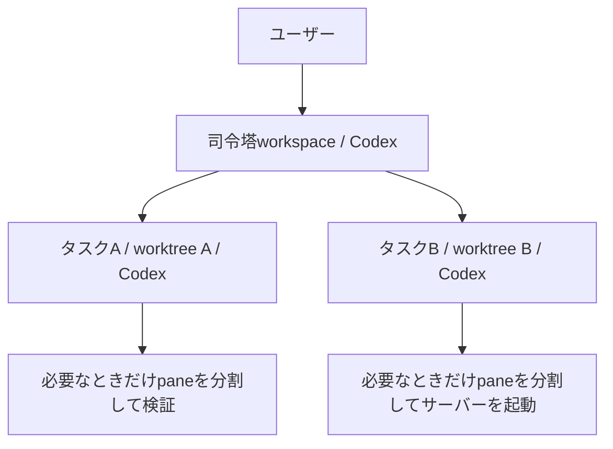

# my-herdr

Herdr上でCodexを司令塔として起動し、タスクごとのworktreeとworkspaceへ作業を分けるための設定集です。
クローンした場所から実行でき、Nixや個人用dotfilesへの依存はありません。



司令塔と作業者は同じHerdrセッションに置きます。
司令塔がタスクごとのworktreeとworkspaceを作り、作業者は担当するworkspace内で端末を分割できます。
この分業はCodexへの指示で行います。
Herdr自体がタスクを自動で計画する仕組みではありません。

## 必要なもの

- macOSまたはLinux
- Herdr v0.9.5以上
- ログイン済みのCodex CLI（`--no-alt-screen`、`--cd`、`--add-dir`対応）
- Git
- Node.js 24.12以上（TypeScriptの直接実行に使用）

HerdrとCodexの導入、ログインは利用者側で済ませてください。
依存確認は`./my-herdr doctor`で行えます。
Herdr外で実行した場合は、その旨を表示して終了コード1を返します。
doctorはHerdrサーバーを操作しません。

## 使い方

次のURLから取得できます。
PRの変更を確認する場合は、取得後に対象のブランチへ切り替えてください。

```bash
git clone https://github.com/kodai12/my-herdr.git
```

まず、作業したいリポジトリでHerdrを起動します。

```bash
herdr
```

Herdr内のシェルから、クローン先のコマンドを実行します。
以下のパスは自分の環境に合わせて指定してください。

```bash
/path/to/my-herdr/my-herdr doctor
/path/to/my-herdr/my-herdr lead /path/to/project '認証画面と設定画面の不具合を、それぞれ調査して修正して'
```

専用workspaceでCodexを起動し、司令塔の役割と依頼を送信します。
元の画面のフォーカスを維持するため、起動後は表示された`herdr workspace focus`コマンドで切り替えてください。
依頼文を省略した場合は、司令塔が起動後に依頼を待ちます。

```bash
/path/to/my-herdr/my-herdr lead /path/to/project
```

リポジトリ内のサブディレクトリを指定してもGitルートを作業場所にします。
初回コミットのないリポジトリでは、作業ブランチの起点が無いため起動を拒否します。
自動で初回コミットを作ることはありません。

## 作業場所

作業用worktreeの既定の配置は次のとおりです。

```text
<親ディレクトリ>/<対象リポジトリ>                  元の作業場所
<親ディレクトリ>/.worktrees/<対象リポジトリ>/<タスク> 作業者用
```

配置先は起動時に変更できます。

```bash
/path/to/my-herdr/my-herdr lead /path/to/project --worktree-root /path/to/checkouts/project
```

起動コマンドは配置先ディレクトリを作り、司令塔のCodexへ`--add-dir`で渡します。
個々のworktreeと作業者は、依頼を受けた司令塔が必要に応じて作成します。
起点は起動時のHEADを既定とし、元の作業場所にある未コミット変更は引き継ぎません。
その変更が必要なら、司令塔が利用者へ扱いを確認します。

## 設定と権限

TypeScriptをNode.js標準の型除去で直接実行するため、利用時のビルドと`npm install`は不要です。
`~/.config/herdr/config.toml`、`~/.codex/config.toml`、既存スキル、フックは書き換えません。
モデルと承認方針は、利用者のCodex設定を引き継ぎます。
Herdr操作がCodexのサンドボックスや承認設定で制限された場合は、その操作について承認してください。
この設定集から承認とサンドボックスを一括無効化することはありません。

操作方法は、導入済みHerdrの`herdr --skill`を司令塔に読ませます。
Herdrの公式スキルを別コピーとして管理する必要はありません。
司令塔の分業方針を変更したい場合は[prompts/orchestrator.md](prompts/orchestrator.md)を編集してください。

任意のHerdr設定例は[config/herdr.example.toml](config/herdr.example.toml)にあります。
既存の設定を置き換えず、必要な項目を手動で取り込んでください。
同じTOMLテーブルを二重に追加すると無効になるため、既存のテーブルへ統合します。

## 分業のルール

| 対象 | 既定の方針 |
|---|---|
| 司令塔と作業者 | いずれもCodex |
| 編集作業 | 作業者ごとに別worktreeと別ブランチ |
| 同時作業者 | 2人まで。変更する場合は指示と環境の余力を確認 |
| 重いテストとビルド | 同時に1件まで |
| workspace、tab、pane | 依頼の範囲内で作成可能。背景操作は`--no-focus` |
| 作業者への依頼 | 担当範囲、完了条件、検証方法、安全操作契約を明示 |
| 成果の確認 | コミットと検証結果を確認。`idle`や`done`だけで完成としない |
| push、PR、デプロイ | 利用者の許可と対象リポジトリの規約に従う |
| 片付け | workspace、worktree、ブランチを自動削除しない |

これらはCodexへ渡す運用指示であり、OSやGitの権限を強制する仕組みではありません。
Herdrの端末は同じ利用者の権限で動きます。
worktreeを分けても、DB、ポート、Docker資源、外部サービスは自動では分離されません。

## 起動に失敗したとき

最初に、使っている実行ファイルとサーバーを確認してください。
Homebrew版などがPATHで先に見つかることがあります。
このコマンドは`HERDR_BIN_PATH`があれば優先して使用します。

```bash
command -v herdr
herdr --version
herdr status
```

バイナリ更新後も、既存サーバーが古いまま動いている場合があります。
サーバーを停止すると実行中のpaneにも影響するため、作業中に再起動して回避しないでください。

途中で失敗しても、作成済みworkspaceと作業場所は保持します。
表示されたworkspace ID、pane ID、エージェント名を使って状態を確認してください。

```bash
herdr workspace list
herdr agent list
herdr agent get <エージェント名>
herdr agent read <エージェント名> --source recent-unwrapped --lines 120
```

承認待ちや初回の信頼確認は、対象paneを開いて利用者が対応してください。
タイムアウトした依頼が既に届いている可能性もあるため、起動コマンドの無条件な再実行や依頼の再送は避けてください。
起動コマンドの成功は依頼の送信までを示し、作業開始と完了は司令塔の状態と出力で確認します。

## 検証

CIと同じコマンドでローカル検証できます。

```bash
npm ci
npm run check
npm test
git diff --check
```

型検査に使うTypeScriptとNode.jsの型定義は開発依存です。
自動テストはNode.js標準のテストランナーと一時Gitリポジトリを使い、HerdrとCodexの実行ファイルをテスト用に差し替えます。
起動引数、送信先、Herdr外での拒否、古いバージョン、応答不備、失敗後の保持を確認します。
実際のHerdrサーバーとCodexの対話画面を検証するものではありません。

実環境の受け入れ確認は、通常作業を含まない専用のnamed sessionで行ってください。
テスト対象のリポジトリも、一時リポジトリを用意します。

1. 通常のシェルから`herdr --session my-herdr-review`を起動する。
2. その中で`my-herdr doctor`と`my-herdr lead <一時リポジトリ>`を実行する。
3. 司令塔に独立した2作業を依頼し、別worktreeと別workspaceでCodexが動くことを確認する。
4. 作業者用paneの追加、背景作成時のフォーカス維持、成果回収を確認する。
5. 同じリポジトリで司令塔をもう一つ起動し、名前が衝突しないことを確認する。
6. 承認待ちと失敗時に既存の作業と未コミット変更が保持されることを確認する。

実環境の受け入れ確認は未実施です。
dotfiles側の既存設定の移管も行っていません。

## 参照

- [Herdr v0.9.5](https://github.com/herdrdev/herdr/releases/tag/v0.9.5)
- [Herdrの自動化](https://herdr.dev/tui/docs/agent-automation/)
- [HerdrのCLI](https://herdr.dev/tui/docs/cli-reference/)
- [Codex CLIの起動オプション](https://developers.openai.com/codex/cli/reference/)
- [Node.jsによるTypeScriptの直接実行](https://nodejs.org/api/typescript.html)

## ライセンス

MIT。詳細は[LICENSE](LICENSE)を参照してください。
